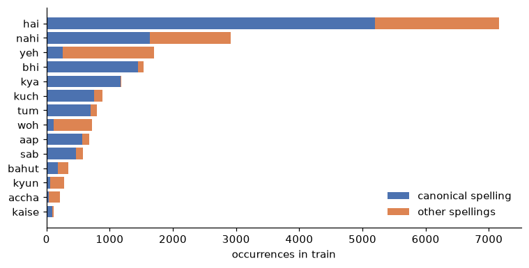
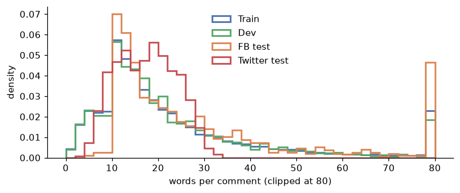
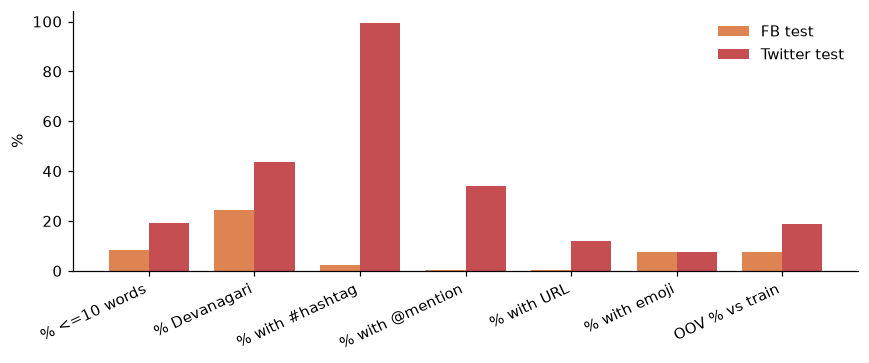
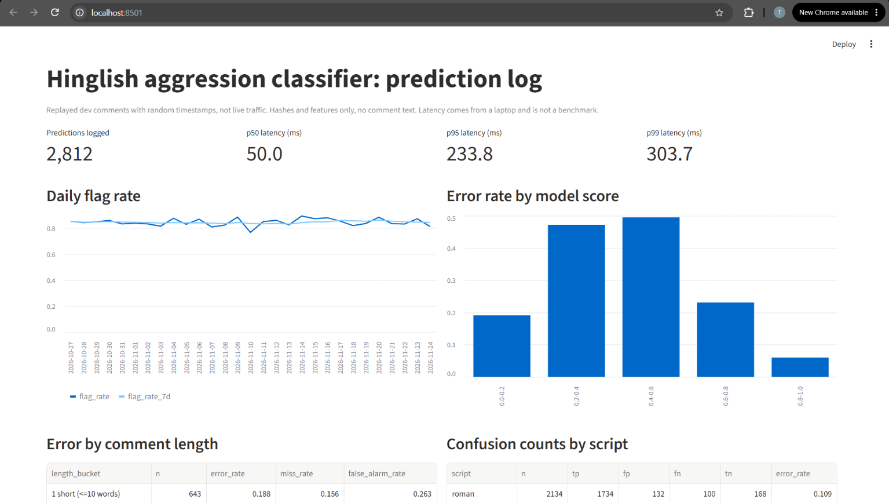

# Hinglish Offensive-Content Classifier

> **Content warning:** this project uses a dataset that contains abusive text. No raw examples are shown anywhere in this repository.

**Status: model development, evaluation, EDA, the serving API with its load test, the Docker image, CI (lint, tests, D9 smoke gate, image build and push) and the SQL analytics layer with its dashboard and a local Kubernetes deployment are finished; drift monitoring and the later layers are next.** The two test sets were scored **once**, on 2026-11-11, after every choice (model, learning rate, threshold, configuration) had been frozen on dev. Sections marked *pending* are not done yet.

## Summary

A classifier for Hindi-English (Hinglish) social-media comments, built step by step with free tools only (local RTX 4050 6 GB laptop GPU, Colab/Kaggle as backup). It compares a TF-IDF baseline with three fine-tuned transformers, using leakage-safe splits, tracked experiments, a decision rule for the threshold fixed in advance, ablations judged by a pre-set bar, a hand-reviewed error audit, and a single sealed test evaluation with bootstrap confidence intervals and McNemar tests.

| Test set | Best model | Macro-F1 (95% CI) | TF-IDF baseline | Recall floor 0.90 held? |
| --- | --- | --- | --- | --- |
| Facebook (in-domain, 970 rows) | HingBERT | **0.843** (0.816 to 0.869) | 0.769 (0.734 to 0.801) | yes, all models |
| Twitter (out-of-domain, 1,194 rows) | no clear winner | all models about **0.60** | 0.597 (0.569 to 0.625) | **no, all models fail** |

- **In domain, HingBERT clearly beats the baseline** (+0.074, interval excludes zero, McNemar significant in all three seeds) and is probably ahead of MuRIL (+0.030, interval only just excludes zero).
- **Out of domain, everything collapses.** The models miss roughly half of the aggressive Twitter comments, and the promise "catch at least 90% of aggression", made on Facebook dev data, does not transfer. The Twitter inputs differ sharply from Facebook (99% carry a hashtag vs 2.5%, 2.4 times as many unseen words), and the models flag only 40% to 54% of tweets as aggressive when 70% are.
- **Label noise is a large part of the remaining error.** In a hand review of 100 model errors, I disagreed with the dataset label in 46 of them (details below).

Hinglish is hard because Hindi words are typed in Roman letters with no fixed spelling, languages switch mid-sentence, and slang changes fast.

## Data

TRAC-1 Hindi (Facebook train/dev, plus a Facebook test set and a surprise Twitter test set), licence **CC-BY-NC-SA 4.0**. The data is not in this repo; see [DATA.md](DATA.md) for how to get it. The raw files have **no header row** (`id, text, label`), and all loaders use `header=None`; row counts are checked against expected values.

- **The label is *aggression*, not "offensive".** The original labels are OAG (overt), CAG (covert) and NAG (none). For a binary task I map **NAG = 0, OAG + CAG = 1**.
- **The positive class is the majority** (about 82% of train). Accuracy is therefore misleading (always predicting "aggressive" scores about 83% on dev), so the headline metric is **macro-F1**.
- Roughly three quarters of the comments are in Roman script and one fifth in Devanagari.

### Splits (official, de-duplicated)

| Split | Raw rows | After cleanup | Aggressive share |
| --- | --- | --- | --- |
| Train | 12,000 | 11,556 | 81.7% |
| Dev | 3,001 | 2,812 | 83.1% |
| Test 1 (Facebook) | 970 | 970 (untouched) | 79.9% |
| Test 2 (Twitter, out of domain) | 1,194 | 1,194 (untouched) | 70.4% |

Leakage found and removed (see `reports/dedupe_report.json`):

- 38 train rows and 15 dev rows also appeared in the Facebook test set.
- 122 dev rows also appeared in train.
- 331 duplicate rows in train and 48 in dev; 1 empty row in train.
- 74 train rows (17 groups) and 4 dev rows (2 groups) were duplicates with **conflicting binary labels**: evidence of label noise, removed as ambiguous.
- The Facebook test set contains 28 internal duplicates; test sets are never modified, only measured.

Duplicates are found with a normaliser that keeps Devanagari vowel signs. (A first version used a regex that deleted them; a unit test now guards against that.)

## Exploratory data analysis

Generated by `notebooks/01_eda.ipynb` (numbers in `reports/eda_summary.md`, charts in `reports/figures/`). Counts and shares only, no raw comments. Train and dev are explored in full; the two test sets are used for **inputs only** (their labels are dropped at load time), and nothing in the notebook changes a model, a threshold or a split.

### What the training data looks like

| Property | Finding |
| --- | --- |
| Class balance | OAG 41.2%, CAG 40.5%, NAG 18.3% in train (81.7% aggressive; dev 83.1%) |
| Length | median 16 words; 23.8% of comments have 10 words or fewer, 13.7% have more than 40 |
| Aggressive share by length | 54.7% for 1-5 words, 77.7% for 6-10, then 85% to 87% for longer comments |
| Script of the comment body | 75.4% Roman, 21.2% Devanagari, 3.4% mixed |
| Aggressive share by script | Roman 84.8%, Devanagari 75.7%, mixed 58.4% |
| Language mix (HingBERT-LID) | 83.4% mostly-Hindi, 13.7% balanced, only 0.4% mostly-English |
| Aggressive share by language mix | mostly-Hindi 83.8%, balanced 78.2%, mostly-English 65.6% (only 64 rows), too-few-words 45.4% (357 rows) |

- **Very short comments are far less aggressive**, and they are also where the model is weakest (error rate 18.8% on comments of 10 words or fewer, see the error analysis).
- **Devanagari and mixed-script comments are less aggressive than Roman ones**, which is part of why dropping the Devanagari training rows hurt in the ablation.
- **The data is almost entirely Hindi-dominant.** Mostly-English comments are too rare for the language-mix slices to say anything reliable about them.

### Spelling variation in Roman Hindi

Train has 180,739 Roman word tokens spread over 21,773 distinct spellings. **59.2% of those spellings occur exactly once**, while the 100 most common spellings cover 41.1% of all tokens. That is the "no fixed spelling" problem in numbers.

Common function words are typed several ways (counts in train):

| Word | Spellings seen (count) |
| --- | --- |
| hai | hai 5206, h 1800, hy 73, hay 60, hae 18 |
| nahi | nahi 1634, nhi 995, nai 177, nahin 69, nahee 19, nahe 19 |
| yeh | ye 1394, yeh 260, yah 25, yh 21 |
| wo / woh | wo 480, vo 126, woh 111, voh 7 |
| bahut | bahut 176, bhut 53, bahot 34, bht 32, bohot 23, bhot 17, bohut 6, bohat 6 |
| acha | acha 102, achha 43, accha 35, achcha 28, achchha 2 |

For yeh, woh, kyun and accha, the spelling I chose as the target of the normaliser is **not** the most common one, so the "canonical" form is just a convention. The normalisation ablation (14 groups like these) still gave no measurable gain.





### Facebook vs Twitter: how the inputs differ

The Twitter test set is not just "more of the same". Inputs compared (percent of comments unless stated):

| Input feature | Train | Dev | FB test | Twitter test |
| --- | --- | --- | --- | --- |
| Median words | 16 | 17 | 20 | 17 |
| 10 words or fewer | 23.8 | 22.9 | 8.3 | 19.0 |
| Body in Roman script | 75.4 | 75.9 | 67.8 | 40.6 |
| Body in Devanagari | 21.2 | 21.2 | 24.2 | **43.5** |
| Mixed script | 3.4 | 3.0 | 7.8 | 15.9 |
| Has a #hashtag | 2.8 | 2.9 | 2.5 | **99.3** |
| Has an @mention | 0.3 | 0.3 | 0.3 | **33.9** |
| Has a URL | 1.5 | 1.4 | 0.4 | **12.1** |
| Has an emoji | 6.2 | 5.8 | 7.5 | 7.7 |
| Mean share of capital letters | 0.08 | 0.08 | 0.08 | **0.24** |
| Words never seen in train | n/a | 8.2 | 7.7 | **18.9** |

- **Tweets are capped at about 30 words** (99th percentile 30, none above 40), while Facebook comments run to 308 words at the 99th percentile.
- **Language mix barely differs** (90.1% of tweets are mostly-Hindi vs 87.7% on Facebook), so this is a platform-style shift, not a language shift.
- **More than twice as many words are unseen** in Twitter (18.9% vs 7.7% to 8.2%), and nearly every tweet carries a hashtag, a third carry a mention, and one in eight a link. Facebook training data has almost none of these.
- **Script is measured on the comment body** (hashtags, mentions and links ignored). The pipeline-style classifier counts the letters of `[URL]`, `[USER]` and Latin hashtags as Latin, which would make Devanagari tweets look "mixed".
- This shows *how* the inputs differ, not *which* difference causes the accuracy drop. A larger Devanagari share alone is unlikely to explain it, since Devanagari comments scored about as well as Roman ones on dev.



### Do the models flag the same share on both platforms?

Using the saved sealed-test probabilities (no model re-run), each model's prediction rate at its own frozen dev threshold, averaged over 3 seeds:

| Test set | True aggressive % | HingBERT | MuRIL | XLM-R | TF-IDF |
| --- | --- | --- | --- | --- | --- |
| Facebook | 79.9 | 82.6 | 84.8 | 85.4 | 84.5 |
| Twitter | 70.4 | **39.8** | **54.0** | **48.8** | **45.3** |

On Facebook the models flag slightly more than the true share, as the recall floor intends. On Twitter they flag only 40% to 54% of comments while 70% are aggressive, so they **under-call aggression** there. This is the same failure as the missed 0.90 recall floor, seen from the output side.

## Method

- **Models:** TF-IDF character n-grams (2-5) + logistic regression; `l3cube-pune/hing-mbert-mixed` (HingBERT, Roman + Devanagari), `google/muril-base-cased`, `FacebookAI/xlm-roberta-base`.
- **Training:** Hugging Face Trainer, class-weighted loss, max length 128, effective batch 16, up to 4 epochs, early stopping on dev macro-F1 (patience 2), bf16.
- **Learning rate:** a small grid (1e-5, 2e-5, 3e-5) on seed 1 for every model, picked on dev by one rule fixed in advance (highest dev macro-F1 at the tuned threshold; ties within 0.003 go to the lower rate). Picked: HingBERT 1e-5, MuRIL 2e-5, XLM-R 1e-5. Then 3 seeds each.
- **Decision rule (D7):** the threshold is tuned **on dev** to maximise macro-F1 subject to a **recall floor of 0.90 on the aggressive class**, then frozen. Every model and every seed is scored the same way, each with its own frozen threshold.
- **Ablations (Layer A):** one change at a time, screened on seed 1 and judged by a bar set beforehand: a difference of **0.010 or more** in tuned dev macro-F1. Anything that moved was confirmed with seeds 2 and 3.
- **Tracking:** MLflow (local SQLite) with parameters, per-epoch metrics, git commit and data hash for every run. The best HingBERT run is registered in the MLflow model registry with its frozen threshold.
- **Sealed test protocol:** `src/sealed_test.py` works in two stages. `score` runs every frozen model on both test sets once, saves the raw probabilities, writes `reports/TEST_SEAL.json` (file hashes, thresholds, git commit) and then refuses to run again. `report` turns the saved probabilities into tables and can be re-run freely because it never touches a model. The whole pipeline was first rehearsed on dev with `--dry-run`, and the adapter was checked to reproduce the dev probabilities saved at training time.
- **Statistics on test:** 2,000 bootstrap resamples of the test set (the same resamples for every model, so differences are paired) with percentile 95% intervals; exact two-sided McNemar tests per seed-matched pair; two comparisons planned in advance (HingBERT vs MuRIL, HingBERT vs TF-IDF) on two test sets, so the Bonferroni level is 0.0125.

## Results

### Dev (model selection)

Mean ± std over 3 seeds for the transformers; the baseline is deterministic. Dev numbers at the tuned threshold are slightly optimistic, because dev picked the threshold.

| Model | Macro-F1 @ 0.5 | Macro-F1 at D7 threshold | Recall, aggressive | Recall, not aggressive |
| --- | --- | --- | --- | --- |
| TF-IDF + LR | 0.740 | 0.751 | 0.928 | 0.556 |
| **HingBERT** (1e-5) | **0.782 ± 0.004** | **0.788 ± 0.002** | 0.943 ± 0.005 | **0.607 ± 0.019** |
| MuRIL (2e-5) | 0.764 ± 0.008 | 0.770 ± 0.002 | 0.939 ± 0.011 | 0.575 ± 0.031 |
| XLM-R base (1e-5) | 0.734 ± 0.006 | 0.754 ± 0.006 | 0.933 ± 0.010 | 0.552 ± 0.011 |

Learning-rate grid (seed 1, tuned macro-F1):

| Model | 1e-5 | 2e-5 | 3e-5 |
| --- | --- | --- | --- |
| HingBERT | 0.790 | 0.782 | 0.778 |
| MuRIL | 0.766 | 0.770 (3 seeds) | 0.629 (training collapsed) |
| XLM-R | 0.754 (3 seeds) | 0.746 | 0.750 |

### Ablations (dev, HingBERT, lr 1e-5)

Bar fixed in advance: 0.010 on tuned macro-F1. Screening compares each single-seed run with the default seed-1 run (0.790); confirmed configurations compare 3-seed means with the default 3-seed mean (0.788 ± 0.002).

| Configuration | Seeds | Tuned macro-F1 | Difference | Verdict by the rule |
| --- | --- | --- | --- | --- |
| Normalisation on (14 function-word groups) | 1 | 0.788 | -0.002 | no measurable effect |
| Max length 256 | 1 | 0.790 | 0.000 | no measurable effect |
| Max length 64 | 1 | 0.785 | -0.005 | no measurable effect |
| Transliterate Devanagari to Roman | 3 | 0.793 ± 0.004 | +0.005 | below the bar; exploratory, not adopted |
| **Train on Roman-script rows only** | 3 | **0.760 ± 0.006** | **-0.028** | **moved, confirmed: Devanagari training data helps** |

- **Max length:** 256 buys nothing and costs about twice the training time; 64 gives up at most 0.005, which is inside seed noise. 128 is kept (about 5.7% of comments are cut at 128 tokens, and it does not hurt). 64 is a candidate for faster serving.
- **Normalisation:** no effect. This shows only that a conservative list of 14 function-word groups does not help; it does not prove spelling variants are irrelevant, since the subword tokenizer may already cope with them.
- **Roman-only training is clearly worse**, about 14 times the seed spread. On the Roman-only model, Devanagari comments scored lowest and Roman comments remained the weak spot for "not aggressive" recall.
- **Transliteration** is the only candidate for an improvement and it is small. It does not clear the pre-set bar, so it is reported as exploratory.
- **Final configuration:** HingBERT, lr 1e-5, max length 128, script as-is, no normalisation. No ablation beat it by the bar.

### Where HingBERT breaks (dev, seed 1)

Automatic slices:

- Share flagged as aggressive by original label: overt (OAG) 96.9%, covert (CAG) 91.2%, non-aggressive (NAG) 38.1%. Covert aggression is caught almost as well as overt; the weak side is **false alarms on non-aggressive comments**.
- Short comments (10 words or fewer) have the worst recall on aggressive text (0.844 vs about 0.96 for longer ones) and an error rate of 18.8% vs 9.2%.
- Script is not a large failure axis: Roman and Devanagari results are close (differences are inside the sampling error of these small slices).
- At the tuned threshold the model makes 140 missed-aggression errors and 181 false alarms on dev (counted from the Layer B prediction log; ONNX fp32 gives the same labels as PyTorch).

### Manual error audit (100 errors, dev, seed 1)

I read 100 errors myself: 50 false alarms (dataset says NAG, model says aggressive) and 50 misses (dataset says aggressive, model says not), half the most confident mistakes and half random. For each I recorded my own judgement of the comment and a failure category. Counts only; no text is published.

| My verdict | False alarms (n=50) | Misses (n=50) | Total |
| --- | --- | --- | --- |
| Dataset label looks doubtful (model arguably right) | 19 | 27 | **46** |
| Model really wrong | 30 | 13 | **43** |
| Unsure | 1 | 10 | 11 |

| Failure category | Count | Of which: dataset label doubtful / model wrong / unsure |
| --- | --- | --- |
| No linguistic pattern (plain miss) | 52 | 16 / 35 / 1 |
| Slang | 11 | 10 / 1 / 0 |
| Ambiguous | 11 | 8 / 3 / 0 |
| Needs context | 10 | 1 / 1 / 8 |
| Negation | 6 | 4 / 2 / 0 |
| Sarcasm | 5 | 5 / 0 / 0 |
| Spelling variant | 1 | 0 / 0 / 1 |
| Label noise (flagged directly) | 1 | 0 / 0 / 1 |
| Not categorised | 3 | 2 / 1 / 0 |

What this says:

- **Covert (CAG) labels are the noisiest.** Of the 32 CAG rows in the sample, I judged 21 not aggressive. This probably caps the achievable score.
- **Most genuine model errors are plain misses** (35 of 43 have no special linguistic pattern), not sarcasm or spelling tricks.
- **Slang and sarcasm cases mostly favour the model:** where the model flagged them, I usually agreed with it.
- **Misses that need context** are mostly cases I could not judge either.

Caveat: this is a hand-picked sample of errors, labelled by one annotator (me). It is **not** a dataset-wide noise rate and must not be read as "46% of labels are wrong".

### Sealed test results (single evaluation)

Scored 2026-11-11 at git commit `c7244a24`. Thresholds frozen on dev; nothing tuned on test. Full tables: `reports/test_results.md`.

**Facebook test (in-domain, 970 rows, aggressive share 0.799)**

| Model | Macro-F1 (mean ± sd over seeds) | 95% CI | Macro-F1 @ 0.5 | Recall aggr. | Recall not-aggr. | Floor 0.90 held? |
| --- | --- | --- | --- | --- | --- | --- |
| HingBERT | 0.843 ± 0.014 | [0.816, 0.869] | 0.847 | 0.957 | 0.694 | yes |
| MuRIL | 0.813 ± 0.005 | [0.782, 0.841] | 0.815 | 0.963 | 0.607 | yes |
| XLM-R | 0.801 ± 0.002 | [0.768, 0.831] | 0.803 | 0.963 | 0.579 | yes |
| TF-IDF | 0.769 | [0.734, 0.801] | 0.771 | 0.945 | 0.549 | yes |

| Comparison | Δ macro-F1 | 95% CI of Δ | CI excludes 0? | McNemar per seed (b, c, p) |
| --- | --- | --- | --- | --- |
| HingBERT − MuRIL | +0.030 | [+0.007, +0.054] | yes | (40, 18, 0.005); (42, 36, 0.572); (45, 34, 0.260) |
| HingBERT − TF-IDF | +0.074 | [+0.045, +0.105] | yes | (71, 23, <0.001); (61, 28, 0.001); (68, 34, 0.001) |

**Twitter test (out-of-domain, 1,194 rows, aggressive share 0.704)**

| Model | Macro-F1 (mean ± sd over seeds) | 95% CI | Macro-F1 @ 0.5 | Recall aggr. | Recall not-aggr. | Floor 0.90 held? |
| --- | --- | --- | --- | --- | --- | --- |
| HingBERT | 0.602 ± 0.053 | [0.575, 0.627] | 0.588 | 0.504 | 0.854 | **no** |
| MuRIL | 0.625 ± 0.027 | [0.600, 0.649] | 0.614 | 0.634 | 0.681 | **no** |
| XLM-R | 0.608 ± 0.052 | [0.583, 0.631] | 0.566 | 0.581 | 0.732 | **no** |
| TF-IDF | 0.597 | [0.569, 0.625] | 0.563 | 0.543 | 0.760 | **no** |

| Comparison | Δ macro-F1 | 95% CI of Δ | CI excludes 0? | McNemar per seed (b, c, p) |
| --- | --- | --- | --- | --- |
| HingBERT − MuRIL | -0.023 | [-0.048, +0.000] | no | (128, 203, <0.001); (157, 159, 0.955); (149, 215, 0.001) |
| HingBERT − TF-IDF | +0.004 | [-0.022, +0.031] | no | (143, 219, <0.001); (204, 140, 0.001); (180, 166, 0.485) |

b = first model right and second wrong, c = the reverse. The three seed pairs are not independent tests.

### How to read the test results

- **In domain, the transformers beat the baseline.** HingBERT leads by a clear margin. Its lead over MuRIL is smaller and less certain: the interval barely excludes zero and McNemar is significant at the 0.0125 level in only one of three seeds.
- **XLM-R vs TF-IDF** (0.801 vs 0.769 on Facebook) was not a planned comparison and the intervals overlap, so it is reported but not claimed. On dev the two were tied.
- **Out of domain, no model can be told apart.** All intervals overlap, HingBERT's seed-to-seed spread (±0.053) is larger than any gap between models, and MuRIL may be slightly ahead but the interval touches zero.
- **The threshold is not the problem.** On Twitter, HingBERT at 0.5 (0.588) is not better than at its frozen threshold (0.602). The shift is in the text itself: the EDA shows nearly every tweet has a hashtag, a third have mentions, and 18.9% of words were never seen in training (7.7% on Facebook).
- **The models under-call aggression on Twitter:** they flag 39.8% (HingBERT) to 54.0% (MuRIL) of tweets against a true share of 70.4%.
- **The confidence intervals cover test-set sampling only,** not seed-to-seed variation, which is reported separately as the ± value.
- **Test scores are higher than dev** (0.843 vs 0.788 for HingBERT). Leakage between train, dev and test was checked and removed, and the sets differ in composition, so the two are not directly comparable.
- **The final model is not changed because of the Twitter result.** The choice of HingBERT was made on dev before the test; switching to MuRIL now would be selecting on test.

### Serving format (decision D8)

Rule fixed before running: adopt a faster format only if macro-F1 at the frozen threshold drops by **no more than 0.010** compared with PyTorch. Champion: HingBERT, seed 1 (threshold 0.57). Dev split (2,812 comments), CPU with 4 threads. Latency is end-to-end (tokenise + model) over 200 single requests; throughput at batch 32. Full table: `reports/optimization.md`.

| Format | Macro-F1 | Drop | Same label as PyTorch | Size (MB) | p50 ms | p95 ms | Comments/s |
| --- | --- | --- | --- | --- | --- | --- | --- |
| PyTorch fp32 | 0.7894 | 0 | 100% | 711 | 26.4 | 63.9 | 15.0 |
| **ONNX fp32** | **0.7894** | **0** | **100%** | 712 | 22.1 | 56.1 | 16.5 |
| ONNX int8 | 0.7757 | -0.0137 | 97.3% | 179 | 9.2 | 22.3 | 43.6 |

- **Decision: serve ONNX fp32.** It gives identical predictions to PyTorch on every dev comment and is modestly faster (p95 12% lower).
- **int8 is rejected by the rule.** It is about 3 times faster and 4 times smaller, but macro-F1 falls by 0.0137 (more than the 0.010 limit), 2.7% of labels change and aggressive recall drops from 0.940 to 0.923.
- **Caveats:** one run (seed 1) and dev only. The int8 loss is measured at the threshold frozen for the fp32 model; int8 shifts the probabilities (mean absolute difference 0.0625), so its result at a re-tuned threshold was not tested, and the bar is not moved after seeing the result. These latencies are single-process micro-benchmarks; the API load test is in the next section.

## Serving and MLOps

### API service

FastAPI app in `src/serve/app.py`, serving the ONNX fp32 model on CPU (trained on a laptop GPU, served on CPU because that is what free hosting offers). The model and tokenizer are loaded once at startup, not per request.

| Endpoint | Purpose |
| --- | --- |
| `POST /predict` | one comment: label, probability, threshold, model version, latency |
| `POST /predict_batch` | 1 to 64 comments in one call |
| `GET /health` | 200 only when the model is loaded (used by the container health check) |
| `GET /version` | model metadata |

- **Input validation:** text must be non-empty and at most 5,000 characters; batches hold 1 to 64 texts.
- **Decision rule:** the label comes from the frozen D7 threshold of the served run (0.57 for HingBERT seed 1), not from 0.5.
- **Logging without raw text:** every prediction is written to SQLite as a salted hash plus cheap features (length, word count, script, Devanagari share, hashtag, mention, URL and emoji flags, label, score, model version, latency). The comment text is never stored. This table feeds the SQL layer later.
- **Settings** are environment variables: `MODEL_DIR`, `LOG_DB` (`off` disables logging), `LOG_SALT`, `ORT_THREADS`, `BUCKET_SIZE`.
- **Tests:** 37 unit and API tests (`python -m pytest -q`).

### Load test (Locust)

One uvicorn process, 4 ONNX Runtime threads, prediction log off, no think time (so users = concurrency). Latency is the full HTTP round trip: JSON, cleaning, tokenising and inference. Full table: `reports/benchmark.md`.

Hardware: Intel64 Family 6 Model 186, 16 logical cores, 17 GB RAM, Windows 11. The load generator ran on the same machine and competed for the CPU. Model file 712 MB; server memory after warm-up 842 MB.

| Batch size | Users | Requests/s | Comments/s | p50 ms | p95 ms | Failures |
| --- | --- | --- | --- | --- | --- | --- |
| 1 | 1 | 40.3 | 40.3 | 20 | 55 | 0 of 1,178 |
| 1 | 4 | 49.5 | 49.5 | 70 | 170 | 0 of 1,445 |
| 1 | 16 | 53.5 | 53.5 | 250 | 680 | 0 of 1,561 |
| 8 | 1 | 2.5 | 19.8 | 430 | 540 | 0 of 219 |
| 8 | 4 | 2.9 | 23.5 | 1,500 | 1,800 | 0 of 259 |
| 32 | 1 | 0.5 | 15.2 | 2,100 | n/a | 0 of 42 |

Percentiles from fewer than 100 requests are shown as n/a (with so few samples, p95 is just the slowest request). The remaining cells are in the full report.

- **Single-comment requests are fast:** p50 20 ms and p95 55 ms with one user, which is what a moderation call looks like.
- **Throughput saturates at about 50 requests/s** (49.5 with 4 users, 53.5 with 16) while latency keeps growing (p95 170 ms, then 680 ms). The service is CPU-bound and extra users just queue.
- **Batching does not raise throughput on this CPU:** 40 to 54 comments/s at batch 1 against 20 to 24 at batch 8 and 15 to 19 at batch 32. A likely cause is that every batch is padded to its longest comment, but I did not isolate that.
- **Memory** grows with batch size and concurrency, from 842 MB after warm-up to 2.8 GB at batch 32 with 16 users.
- **No failed requests** in any run.

**Length bucketing was tested and is not claimed.** The batch endpoint can sort comments by length and run them in small groups (`BUCKET_SIZE`). Two benchmark runs of that were invalid: the laptop throttled (the CPU clock fell from 2,400 to 1,520 MHz during the second run) and the ratios contradicted each other (0.38x at one concurrency level, 2.01x at another for the same batch size). The result is inconclusive, so the table above is the only benchmark reported. It was measured before bucketing existed, which is equivalent to bucketing off (`BUCKET_SIZE=1000`).

### Container

`docker/Dockerfile`: `python:3.13-slim`, CPU-only pinned dependencies (`requirements-serve.txt`: FastAPI, uvicorn, ONNX Runtime, tokenizers, numpy; no PyTorch), a non-root user, and a health check with a 60 s start period because the model loads at startup. The 712 MB model is **not** baked into the image: it is mounted at `/models`, which keeps the image at **465 MB** and keeps the model out of git.

```powershell
docker build -f docker/Dockerfile -t hinglish-classifier:dev .
docker run --rm -p 8000:8000 -v "${PWD}\serving\model:/models:ro" hinglish-classifier:dev
# then open http://localhost:8000/docs
```

Check: the container and the local virtual-environment server returned identical labels and probabilities (to 4 decimals) on three test comments (Roman Hindi, mixed Roman, Devanagari).

### CI/CD (GitHub Actions)

`.github/workflows/ci.yml` runs on every pull request and every push to `main`:

| Job | What it does | Runs after |
| --- | --- | --- |
| `test` | installs pinned dependencies, lints (`ruff`, syntax errors and undefined or unused names only), runs the 37 tests | n/a |
| `gate` | downloads the model bundle and the smoke set from a private Hugging Face repo and runs `src/smoke_eval.py` (decision D9) | `test` |
| `image` | builds the Docker image; on push to `main` also pushes it to the GitHub Container Registry, tagged with the commit SHA and `latest` | `test`, `gate` |

Because `image` needs `gate`, a commit that fails the gate never produces an image. Deployment itself is manual (D9): CI builds and publishes, a person decides what runs.

**The D9 smoke gate** runs the served model on a frozen sample of **300 dev comments** (stratified by label, fixed seed; dev only, the sealed test sets are never used). All three checks must pass:

| Check | Limit | Why |
| --- | --- | --- |
| Label agreement with reference labels saved from the registered model | at least 99% | Catches a broken preprocessing step or a swapped model with no sampling noise. ONNX fp32 matched PyTorch on 100% of dev labels, so a healthy build sits at 100%. |
| Macro-F1 against the true labels | at least 0.72 | A coarse safety net. The registered model scores 0.788 on this sample, and with only 51 non-aggressive rows a tight limit would fail good commits at random. |
| p95 latency of single predictions (model call only) | at most 250 ms | Local p95 is about 55 ms; shared CI runners are slower and noisier, so the limit is generous. The gate passes in CI, but the runner's p95 has not been recorded here, so recalibration is still open. |

- **Why not "2 points below the registered model"?** With about 17% non-aggressive comments, a 200-comment sample holds roughly 34 of them, and macro-F1 on that swings by several points from sampling noise alone.
- **Data stays private.** The smoke set and the model live in a private Hugging Face repo (read-only token stored as a GitHub secret). The comments are licensed (CC-BY-NC-SA 4.0) and abusive, so they never enter this repo, and the script prints no comment text, because CI logs of a public repo are public.
- **What it cannot catch:** quality drops on kinds of comments the 300 do not cover, and any drift in production traffic. It is a regression tripwire, not an evaluation.
- **Status:** all three jobs (`test`, `gate`, `image`) run green on `main`, and the image is published to the GitHub Container Registry.

**CI proof: a bad commit is blocked.** Pull request #1 deliberately truncated every comment to 4 words in the serving text cleaner (`src/serve/text.py`). The `test` job failed, because `test_text_helpers_match_the_training_versions` compares the serving cleaner with the training cleaner. The `gate` and `image` jobs depend on `test`, so both were skipped and nothing was published. The PR was closed without merging.

Limitation: the block came from the unit test, not from the smoke gate. The gate has passed on `main` but has not yet been shown failing. A bug inside the model path, which the unit tests (they use a fake predictor) cannot see, would be the real test of it, and that second proof is not done.


## Layer B: SQL analytics and dashboard

The API writes every prediction to SQLite as a salted hash plus cheap features (see Serving). Layer B puts analyst-style queries on top of that table.

**The data is replayed, not live traffic.** There is no real traffic, so `src/analytics/replay.py` sends the 2,812 frozen dev comments through the served ONNX model one at a time and writes the same `predictions` table the API writes. Timestamps are random, spread over 28 days, so the rolling-window queries have something to roll over. True dev labels sit in a separate `feedback` table, keyed by the same salted hash (`src/analytics/add_feedback.py`), so error rates can be computed without storing any text.

Eight saved queries live in `sql/` (CTEs, window functions and a self-join); `src/analytics/run_queries.py` runs them all and saves the results to `reports/sql/` (counts only).

| Query | What it answers | Technique |
| --- | --- | --- |
| `01_daily_flag_rate` | daily volume, flag rate and rolling 7-day flag rate | CTE, window function |
| `02_by_script` | flag rate, mean score and latency per script | group by |
| `03_confidence_vs_error` | error rate per score bucket | join, CTE |
| `04_error_by_length` | error, miss and false-alarm rate per length bucket | join, CTE |
| `05_slowest_requests` | the 10 slowest requests, with features only | order by, limit |
| `06_latency_percentiles` | p50, p95, p99 without a percentile function | window function |
| `07_biggest_daily_jumps` | largest day-over-day changes in flag rate | self-join |
| `08_confusion_by_script` | tp, fp, fn, tn per script | join, conditional counts |



The Streamlit dashboard (`src/analytics/dashboard.py`, run locally) shows these queries; every panel is one saved query file and the dashboard holds no logic of its own.

What the queries show:

- **The log reproduces the earlier numbers.** The confusion counts add up to 2,197 true positives, 181 false alarms, 140 misses and 294 true negatives, which gives macro-F1 0.789, matching `reports/optimization.md`.
- **Confidence is informative.** 77% of comments score 0.8 or higher and are wrong 6% of the time; comments scored between 0.2 and 0.6 are wrong 47% to 50% of the time.
- **Short comments are the weak spot again:** error rate 18.8% for 10 words or fewer, against 9.2% for longer ones, the same as in the dev error analysis.
- **The slowest requests are long Devanagari comments** (mean latency 92 ms for Devanagari against 66 ms for Roman), probably because they produce more tokens. This was not isolated.
- **Day-to-day noise is large.** With about 100 comments a day, the flag rate moved by up to 0.118 from one day to the next from sampling alone, so a drift alert should watch the 7-day rate, not a single day.

Limits, stated plainly:

- The data is replayed dev comments with random timestamps. Nothing here says how the service behaves under real traffic.
- Error rates are dev numbers, and dev picked the model and the threshold, so they are optimistic.
- Latency in the log is **not a benchmark**: the replay measured p95 234 ms, against about 55 ms in the Locust run and the smoke gate, because the laptop was slower during the replay. The Locust report is the one to quote.
- The plan's "most frequent terms per class" and "clusters by language mix" are not possible: the log has no text and no language-mix column, by design (licence, abusive content). Slices by script and length replace them.
- The script slice here is measured on the comment body (595 Devanagari and 83 mixed comments), so it differs from the older dev error analysis (559 and 119), which counted the letters of `[URL]`, `[USER]` and Latin hashtags as Latin.

## Kubernetes (kind, local)

The serving image runs in a local Kubernetes cluster made with **kind** (Kubernetes inside Docker). Decision D10: **no public hosting**. A free public host would have meant either a paid plan, a card on file, or a cold start with a 712 MB model, so the deployment is local and documented instead. The manifests are in `k8s/`.

| File | What it is |
| --- | --- |
| `k8s/kind-config.yaml` | One-node cluster that shares the `serving/model` folder into the node at `/models` (kind's version of `docker run -v`) |
| `k8s/deployment.yaml` | 2 replicas of `hinglish-classifier:dev`, rolling updates, probes, resource limits |
| `k8s/service.yaml` | A stable in-cluster address in front of whichever Pods are Ready |

Key settings and why:

| Setting | Value | Why |
| --- | --- | --- |
| Replicas | 2 | One can die without the service going away |
| Rolling update | `maxUnavailable: 0`, `maxSurge: 1` | A new Pod must be Ready before an old one is retired |
| Startup probe | `/health`, every 5 s, up to 24 failures (120 s) | The model loads at startup; this stops the liveness probe from restarting a Pod that is only still loading |
| Readiness probe | `/health`, every 10 s | A failing Pod is taken out of the Service but not restarted |
| Liveness probe | `/health`, every 20 s | A stuck Pod is killed and recreated |
| Resources | request 500m CPU and 1 GiB; limit 2 CPU and 3 GiB | Server memory is about 850 MB after warm-up and reached 2.8 GB in the load test at batch 32 with 16 users |
| `ORT_THREADS` | 2 | Matches the CPU limit, so ONNX Runtime does not get throttled |
| User | uid 10001, `runAsNonRoot` | Matches the non-root user in the Dockerfile |
| Model | read-only `hostPath` volume at `/models` | The model stays out of the image and out of git |
| Prediction log | `emptyDir` at `/data` | Scratch space; it is deleted with the Pod |

Run it (Windows PowerShell, Docker Desktop running):

```powershell
kind create cluster --config k8s/kind-config.yaml
kind load docker-image hinglish-classifier:dev --name hinglish    # kind cannot see local images until they are loaded
kubectl apply -f k8s/deployment.yaml -f k8s/service.yaml
kubectl rollout status deployment/hinglish-classifier
kubectl port-forward service/hinglish-classifier 8080:8000        # then http://localhost:8080/docs
```

What was demonstrated on the laptop:

- **Deploy.** Both Pods reached `1/1 Running` about 12 s after `kubectl apply` (the model loads in about 11 s), the rollout completed, and `/predict` and `/version` answered through the port-forward with the registered model version.
- **Self-healing.** I deleted one Pod. The Deployment created a replacement within 2 s and it was Ready after 12 s; the other Pod stayed `1/1 Running` throughout.
- **Bad release and rollback.** I pointed the Deployment at an image tag that does not exist. It started one new Pod and left both old Pods running, because of `maxUnavailable: 0`. `kubectl rollout undo` removed the broken Pod and the two original Pods were still `1/1 Running`.
- **Gotcha.** `kubectl rollout undo` switches to the *previous* revision, so running it twice re-deploys the bad one. Naming the image explicitly (`kubectl set image ... api=hinglish-classifier:dev`) is safer.

Not demonstrated: a readiness-probe failure on purpose, and traffic during the rollback (I did not send requests while the bad Pod was starting).

## Upcoming (planned, not built)

Nothing in this section exists yet. It is listed so the scope of the finished work is clear.

**Drift monitoring (Phase 7).** There is no real traffic, so any shift would be simulated, apart from the real Facebook-to-Twitter shift already shown in the EDA.
- Signals computed from the prediction log (flag rate, script, length, hashtag share) and from text (unseen-word rate against the training vocabulary).
- Three comparisons: dev vs another dev slice (the detector must stay quiet), a deliberately shifted dev slice, and Facebook vs Twitter inputs. Inputs only, no test labels.
- A review rule written before running, and a manual workflow that produces a drift report. Retraining stays a local, human-approved step that registers a challenger, never the champion.
- Data drift can be seen without labels; concept drift cannot.

**Explainability and calibration (Layer C).** Token-level explanations on model errors, a reliability diagram with expected calibration error, and temperature scaling fitted on dev.

**Decision-model and LLM benchmark (Layer D).** A four-way comparison (TF-IDF, fine-tuned HingBERT, a decision-model contender, an LLM) with a protocol and adoption rule fixed before running.

**Smaller open items**
- Rewrite one model with a hand-written training loop.
- Show the smoke gate itself failing (a bug inside the model path).
- Record the CI runner's p95 latency and recalibrate the gate limit.
- Re-test length bucketing on a machine that does not throttle.
- Make the cluster pull the GHCR image instead of a hand-loaded one, and move the log salt into a Secret.
- Choose a code licence.
  
## Limitations

- The data measures aggression, not "offensive" in a product sense, and comes from 2018 Facebook/Twitter pages with a heavily inflated aggressive share. Precision in real traffic would look different.
- One dataset, one language pair. Slang drift is not measured; drift monitoring will use a simulated shift (and, as a real example, the Twitter set).
- **The recall floor does not survive a platform change.** It held on Facebook and failed for every model on Twitter.
- **Frozen thresholds are unstable across seeds** (for example HingBERT 0.14 to 0.57, MuRIL 0.10 to 0.62), a side effect of class-weighted training plus the recall-floor rule. Scores at the frozen threshold are therefore sensitive to the seed.
- The test sets are small (970 and 1,194), so intervals are wide; HingBERT vs MuRIL is only weakly resolved even in domain.
- Label noise exists (conflicting duplicate labels, and a hand audit where I disagreed with the dataset label in 46 of 100 errors) and caps achievable scores. The audit is one annotator and a non-random sample.
- HingBERT's best learning rate sits at the edge of the grid; a lower rate was not tried, to keep the search equal across models.
- Several ablations were screened on one seed only (normalisation, max length 64 and 256). Normalisation was tested with a hand-written list of 14 function-word groups, not a full spelling normaliser.
- The language-ID model (HingBERT-LID) has no "other" class and mislabels some Roman-Hindi words that look like English words, so language-mix slices are approximate.
- MuRIL failed to train at 3e-5 (loss stayed at chance level); this is a learning-rate sensitivity, not a statement about the model.
- The Facebook test set contains 28 internal duplicates, kept because test sets are never modified.
- The Twitter set differs from Facebook in many ways at once (hashtags, mentions, links, vocabulary, length cap, script mix), so the EDA cannot say which one causes the drop; isolating it would need a controlled experiment.
- The `script` slice in the dev error analysis counts the letters of `[URL]`, `[USER]` and Latin hashtags as Latin. This barely affects Facebook (few hashtags, mentions or links) but would distort Twitter; the EDA uses a body-only script measure instead.
- The load test ran on a Windows laptop with the load generator on the same machine, and the CPU can throttle (it did during the bucketing runs). Absolute numbers will differ elsewhere; the shape (saturation near 50 requests/s, batching not helping) is the finding.
- Length bucketing in the batch endpoint is untested: the two benchmark runs were invalid and are not reported.
- The smoke gate uses 300 comments, 51 of them non-aggressive, so its macro-F1 limit is deliberately loose. Its latency limit comes from a laptop measurement and needs recalibrating on the CI runner.
- The smoke gate has never been shown failing on its own: the one bad-commit proof was stopped earlier, by the unit test.
- The Layer B log is replayed dev data with random timestamps, so its time patterns and latencies say nothing about real traffic.
- **Not publicly hosted** (D10): the Kubernetes deployment runs on one laptop. kind has a single node, so the two replicas share the same CPU; this shows healing, probes and rollback, not real scaling.
- `kind-config.yaml` contains a hard-coded Windows path to the model folder; anyone else has to edit it.
- The prediction log in the cluster lives in an `emptyDir` and disappears with the Pod. A real deployment would need a persistent volume, and the log salt would need to come from a Secret (the default `change-me` is used here).
- The image is `hinglish-classifier:dev`, loaded into kind by hand. CI pushes a tagged image to the GitHub Container Registry, but the cluster does not pull it.
- The CI gate depends on a private Hugging Face repo, so others cannot reproduce it without building their own copy of the model bundle and smoke set (`src/make_smoke_set.py`, `src/upload_ci_assets.py`).

## Reproduce (Windows PowerShell)

```powershell
git clone https://github.com/teerthgangwar25/hinglish-classifier.git
cd hinglish-classifier
python -m venv .venv
.venv\Scripts\Activate.ps1
# install PyTorch (CUDA build) from https://pytorch.org/get-started/locally/
pip install -r requirements.txt

# put the CSVs in data\raw (see DATA.md), then:
python src/verify_data.py          # checks the files against data_checksums.json
python src/split.py                # frozen, de-duplicated splits
python src/train_baseline.py

python src/train_transformer.py --model hingbert --seed 1 --lr 1e-5
python src/train_transformer.py --model muril    --seed 1 --lr 2e-5
python src/train_transformer.py --model xlmr     --seed 1 --lr 1e-5
python src/summarize.py            # mean +/- std table -> reports\dev_summary.md
mlflow ui --backend-store-uri sqlite:///mlflow.db

# error analysis (dev only) and model registration
python src/langmix.py --split dev
python src/langmix.py --split train      # also fb_test and tw_test, needed by the EDA notebook
python src/langmix.py --split fb_test
python src/langmix.py --split tw_test
python src/error_analysis.py --run hingbert_lr1e-05_seed1
python src/register_best.py --model hingbert --lr 1e-05

# EDA: pip install notebook ipykernel matplotlib, then run notebooks/01_eda.ipynb top to bottom

# ablations (dev only), e.g. the confirmation stage
powershell -ExecutionPolicy Bypass -File .\run_ablations.ps1 -Only roman_train,translit -Seeds 2,3 -ChunkMinutes 40

# serving optimisation (Phase 4): ONNX export, int8, and the D8 comparison on dev
pip install onnx onnxruntime
python src/export_onnx.py

# sealed test evaluation: rehearse on dev, then run ONCE
python src/test_adapter.py hingbert_lr1e-05_seed1   # adapter check against saved dev probabilities
python src/sealed_test.py score --dry-run
python src/sealed_test.py report --dry-run
python src/sealed_test.py score --confirm           # refuses to run a second time
python src/sealed_test.py report                    # re-runnable, reads the saved scores

# serving (Phase 4): build the model bundle, run the API, load-test it
python src/serve/prepare_bundle.py
uvicorn serve.app:app --app-dir src --port 8000      # docs at http://localhost:8000/docs
python src/benchmark/run_benchmark.py --users 1,4,16 --batches 1,8,32 --report benchmark.md

# container (Docker Desktop must be running)
docker build -f docker/Dockerfile -t hinglish-classifier:dev .
docker run --rm -p 8000:8000 -v "${PWD}\serving\model:/models:ro" hinglish-classifier:dev

# CI assets and the D9 smoke gate (dev only)
python src/make_smoke_set.py                         # writes data\smoke\smoke_set.csv
python src/smoke_eval.py --model-dir serving/model --smoke-csv data/smoke/smoke_set.csv
python src/upload_ci_assets.py                       # needs a Hugging Face WRITE token in $env:HF_TOKEN

# Layer B: replayed prediction log, saved queries, dashboard (dev only)
python src/analytics/replay.py                       # writes logs\replay.db (git-ignored)
python src/analytics/add_feedback.py                 # true dev labels, keyed by the same hash
python src/analytics/run_queries.py                  # writes reports\sql\*.md
pip install streamlit
streamlit run src/analytics/dashboard.py             # http://localhost:8501

# Kubernetes (kind): see the Kubernetes section; edit the model path in k8s/kind-config.yaml first
kind create cluster --config k8s/kind-config.yaml
kind load docker-image hinglish-classifier:dev --name hinglish
kubectl apply -f k8s/deployment.yaml -f k8s/service.yaml
```

Tests: `python -m pytest -q`

## Resume work after a restart (Windows PowerShell)

Everything (virtual environment, MLflow server) is off after a shutdown. The data, models and the MLflow database live on disk and are not lost.

**Terminal 1: environment**

```powershell
cd "D:\Projects\Hinglish Offensive-Content Classifier"
.venv\Scripts\Activate.ps1
# if PowerShell blocks the script, allow it for this window only, then repeat the line above:
#   Set-ExecutionPolicy -Scope Process -ExecutionPolicy Bypass

git status                                                    # see where you stopped
python -c "import torch; print(torch.cuda.is_available())"    # True = the RTX 4050 is visible
python -m pytest -q                                           # all unit tests should pass
python src/verify_data.py                                     # raw data files unchanged
```

**Terminal 2: MLflow UI** (open a second PowerShell window, same two first lines, then:)

```powershell
mlflow ui --backend-store-uri sqlite:///mlflow.db
```

Open http://127.0.0.1:5000. Experiments are `transformers`, `ablations`, `tfidf-baseline`, `smoke`, and the model registry is under the **Models** tab (`hinglish-offensive-classifier`, alias `champion`). Run the command from the repo root, because the database path is relative. If the port is busy, add `--port 5001`. Stop the server with Ctrl+C.

**Phase 4 packages and the optimisation comparison**

```powershell
pip install onnx onnxruntime
python src/export_onnx.py --force      # writes models\onnx\<run>\ and reports\optimization.md
```

## Repository layout

```
src/
  preprocess.py        loading, light cleaning, de-duplication key, ablation text options
  split.py             leakage-safe splits and the dedupe report
  verify_data.py       checksums for the raw files
  evaluate.py          shared metrics
  thresholds.py        D7 threshold under a recall floor
  tracking.py          MLflow helpers
  train_baseline.py    TF-IDF + logistic regression
  train_transformer.py Trainer-based fine-tuning, with ablation flags
  summarize.py         dev results table from MLflow
  register_best.py     registers the best run in the MLflow model registry
  langmix.py           script class and Hindi share per comment (HingBERT-LID)
  error_analysis.py    slice metrics and a hand-review file (git-ignored)
  test_adapter.py      how frozen runs are loaded for the sealed test
  sealed_test.py       one-time test evaluation, bootstrap CIs, McNemar
  export_onnx.py       ONNX fp32 + int8 export and the PyTorch/ONNX/int8 comparison (D8)
  serve/               FastAPI service (app.py, text.py, prepare_bundle.py)
  benchmark/           Locust load-test runner
  make_smoke_set.py    builds the 300-comment dev smoke set (D9), output git-ignored
  smoke_eval.py        the D9 gate: agreement, macro-F1 floor, p95 latency
  upload_ci_assets.py  uploads the model bundle and smoke set to the private HF repo
  analytics/           replay.py, add_feedback.py, run_queries.py, dashboard.py (Layer B)
run_ablations.ps1      chunked runner for the ablation experiments
sql/                   eight saved queries on the prediction log (Layer B)
k8s/                   kind config, Deployment and Service manifests
docker/Dockerfile      CPU-only serving image
requirements-serve.txt pinned runtime dependencies for the API
.github/workflows/ci.yml   lint, tests, smoke gate, image build and push
notebooks/01_eda.ipynb exploratory analysis (counts and charts only)
tests/                 unit tests (preprocess, thresholds, langmix)
splits/                frozen id lists (ids only)
reports/               dedupe report, dev summary, error analysis (counts only),
                       test_results.md, TEST_SEAL.json, eda_summary.md, optimization.md, benchmark.md,
                       eda/ (csv tables), sql/ (query results), figures/ (png charts)
                       (reports/test_scores/ holds test labels and is git-ignored)
decisions.md           decision log
```

## Roadmap

- [x] Leakage-safe splits and dedupe report
- [x] TF-IDF baseline
- [x] Three transformers, learning-rate selection, 3 seeds, D7 threshold
- [x] Dev error-analysis tooling, manual review of 100 errors
- [x] Best model registered in MLflow
- [x] Layer A: ablations with a pre-set rule, language-mix slices, single sealed test evaluation with bootstrap CIs and McNemar
- [x] Layer A: EDA notebook (class balance, lengths, script and language mix, spelling variants of common Hindi words, Facebook vs Twitter inputs)
- [ ] Rewrite one model with a hand-written training loop
- [x] ONNX export and int8 quantisation, compared by the pre-set rule (ONNX fp32 chosen)
- [x] FastAPI service and Locust latency benchmark
- [x] Docker image (465 MB, CPU only, model mounted rather than baked in)
- [x] CI: lint, tests, image build and push to the GitHub Container Registry
- [x] CI evaluation gate (D9): green in CI; a deliberately bad commit was blocked (by the unit test; the gate itself not yet shown failing)
- [x] SQL analytics and dashboard (replayed dev data, 8 saved queries, Streamlit)
- [x] Kubernetes (kind): Deployment, Service, probes, resource limits; self-healing and rollback shown locally (no public hosting, D10)
- [ ] Drift monitoring (simulated shift plus the real Facebook-to-Twitter shift)
- [ ] Explainability and calibration
- [ ] Benchmark against a decision-model contender and an LLM

## Data licence and citation

The dataset is CC-BY-NC-SA 4.0 (non-commercial, share-alike) and is not redistributed here, and the test labels are kept out of the repo. Please cite the dataset as requested on the shared-task page: https://sites.google.com/view/trac1/shared-task

*Code licence: MIT,Apache-2.0.*
