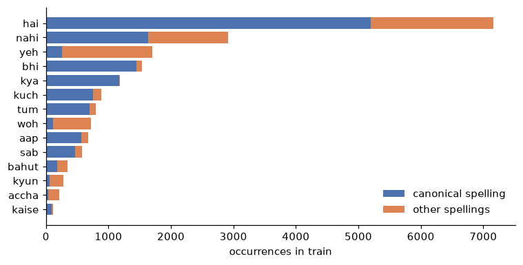
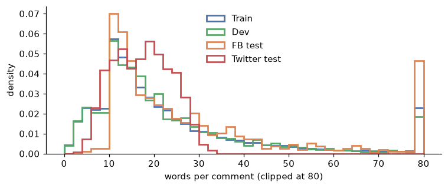
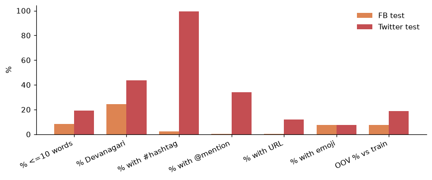

# Hinglish Offensive-Content Classifier

> **Content warning:** this project uses a dataset that contains abusive text. No raw examples are shown anywhere in this repository.

**Status: model development, evaluation and EDA are finished; serving and MLOps are next.** The two test sets were scored **once**, on 2026-11-11, after every choice (model, learning rate, threshold, configuration) had been frozen on dev. Sections marked *pending* are not done yet.

## Summary

A classifier for Hindi-English (Hinglish) social-media comments, built step by step with free tools only (local RTX 4050 6 GB laptop GPU, Colab/Kaggle as backup). It compares a TF-IDF baseline with three fine-tuned transformers, using leakage-safe splits, tracked experiments, a decision rule for the threshold fixed in advance, ablations judged by a pre-set bar, a hand-reviewed error audit, and a single sealed test evaluation with bootstrap confidence intervals and McNemar tests.

| Test set | Best model | Macro-F1 (95% CI) | TF-IDF baseline | Recall floor 0.90 held? |
| --- | --- | --- | --- | --- |
| Facebook (in-domain, 970 rows) | HingBERT | **0.843** (0.816 to 0.869) | 0.769 (0.734 to 0.801) | yes, all models |
| Twitter (out-of-domain, 1,194 rows) | no clear winner | all models about **0.60** | 0.597 (0.569 to 0.625) | **no, all models fail** |

- **In domain, HingBERT clearly beats the baseline** (+0.074, interval excludes zero, McNemar significant in all three seeds) and is probably ahead of MuRIL (+0.030, interval only just excludes zero).
- **Out of domain, everything collapses.** The models miss roughly half of the aggressive Twitter comments, and the promise "catch at least 90% of aggression", made on Facebook dev data, does not transfer. The Twitter inputs differ sharply from Facebook (99% carry a hashtag vs 2.5%, 2.4 times as many unseen words), and the models flag only 40% to 54% of tweets as aggressive when 70% are.
- **Label noise is a large part of the remaining error.** In a hand review of 100 model errors, I disagreed with the dataset label in 46 of them (details below).

Hinglish is hard because Hindi words are typed in Roman letters with no fixed spelling, languages switch mid-sentence, and slang changes fast.

## Data

TRAC-1 Hindi (Facebook train/dev, plus a Facebook test set and a surprise Twitter test set), licence **CC-BY-NC-SA 4.0**. The data is not in this repo; see [DATA.md](DATA.md) for how to get it. The raw files have **no header row** (`id, text, label`), and all loaders use `header=None`; row counts are checked against expected values.

- **The label is *aggression*, not "offensive".** The original labels are OAG (overt), CAG (covert) and NAG (none). For a binary task I map **NAG = 0, OAG + CAG = 1**.
- **The positive class is the majority** (about 82% of train). Accuracy is therefore misleading (always predicting "aggressive" scores about 83% on dev), so the headline metric is **macro-F1**.
- Roughly three quarters of the comments are in Roman script and one fifth in Devanagari.

### Splits (official, de-duplicated)

| Split | Raw rows | After cleanup | Aggressive share |
| --- | --- | --- | --- |
| Train | 12,000 | 11,556 | 81.7% |
| Dev | 3,001 | 2,812 | 83.1% |
| Test 1 (Facebook) | 970 | 970 (untouched) | 79.9% |
| Test 2 (Twitter, out of domain) | 1,194 | 1,194 (untouched) | 70.4% |

Leakage found and removed (see `reports/dedupe_report.json`):

- 38 train rows and 15 dev rows also appeared in the Facebook test set.
- 122 dev rows also appeared in train.
- 331 duplicate rows in train and 48 in dev; 1 empty row in train.
- 74 train rows (17 groups) and 4 dev rows (2 groups) were duplicates with **conflicting binary labels**: evidence of label noise, removed as ambiguous.
- The Facebook test set contains 28 internal duplicates; test sets are never modified, only measured.

Duplicates are found with a normaliser that keeps Devanagari vowel signs. (A first version used a regex that deleted them; a unit test now guards against that.)

## Exploratory data analysis

Generated by `notebooks/01_eda.ipynb` (numbers in `reports/eda_summary.md`, charts in `reports/figures/`). Counts and shares only, no raw comments. Train and dev are explored in full; the two test sets are used for **inputs only** (their labels are dropped at load time), and nothing in the notebook changes a model, a threshold or a split.

### What the training data looks like

| Property | Finding |
| --- | --- |
| Class balance | OAG 41.2%, CAG 40.5%, NAG 18.3% in train (81.7% aggressive; dev 83.1%) |
| Length | median 16 words; 23.8% of comments have 10 words or fewer, 13.7% have more than 40 |
| Aggressive share by length | 54.7% for 1-5 words, 77.7% for 6-10, then 85% to 87% for longer comments |
| Script of the comment body | 75.4% Roman, 21.2% Devanagari, 3.4% mixed |
| Aggressive share by script | Roman 84.8%, Devanagari 75.7%, mixed 58.4% |
| Language mix (HingBERT-LID) | 83.4% mostly-Hindi, 13.7% balanced, only 0.4% mostly-English |
| Aggressive share by language mix | mostly-Hindi 83.8%, balanced 78.2%, mostly-English 65.6% (only 64 rows), too-few-words 45.4% (357 rows) |

- **Very short comments are far less aggressive**, and they are also where the model is weakest (error rate 18.8% on comments of 10 words or fewer, see the error analysis).
- **Devanagari and mixed-script comments are less aggressive than Roman ones**, which is part of why dropping the Devanagari training rows hurt in the ablation.
- **The data is almost entirely Hindi-dominant.** Mostly-English comments are too rare for the language-mix slices to say anything reliable about them.

### Spelling variation in Roman Hindi

Train has 180,739 Roman word tokens spread over 21,773 distinct spellings. **59.2% of those spellings occur exactly once**, while the 100 most common spellings cover 41.1% of all tokens. That is the "no fixed spelling" problem in numbers.

Common function words are typed several ways (counts in train):

| Word | Spellings seen (count) |
| --- | --- |
| hai | hai 5206, h 1800, hy 73, hay 60, hae 18 |
| nahi | nahi 1634, nhi 995, nai 177, nahin 69, nahee 19, nahe 19 |
| yeh | ye 1394, yeh 260, yah 25, yh 21 |
| wo / woh | wo 480, vo 126, woh 111, voh 7 |
| bahut | bahut 176, bhut 53, bahot 34, bht 32, bohot 23, bhot 17, bohut 6, bohat 6 |
| acha | acha 102, achha 43, accha 35, achcha 28, achchha 2 |

For yeh, woh, kyun and accha, the spelling I chose as the target of the normaliser is **not** the most common one, so the "canonical" form is just a convention. The normalisation ablation (14 groups like these) still gave no measurable gain.





### Facebook vs Twitter: how the inputs differ

The Twitter test set is not just "more of the same". Inputs compared (percent of comments unless stated):

| Input feature | Train | Dev | FB test | Twitter test |
| --- | --- | --- | --- | --- |
| Median words | 16 | 17 | 20 | 17 |
| 10 words or fewer | 23.8 | 22.9 | 8.3 | 19.0 |
| Body in Roman script | 75.4 | 75.9 | 67.8 | 40.6 |
| Body in Devanagari | 21.2 | 21.2 | 24.2 | **43.5** |
| Mixed script | 3.4 | 3.0 | 7.8 | 15.9 |
| Has a #hashtag | 2.8 | 2.9 | 2.5 | **99.3** |
| Has an @mention | 0.3 | 0.3 | 0.3 | **33.9** |
| Has a URL | 1.5 | 1.4 | 0.4 | **12.1** |
| Has an emoji | 6.2 | 5.8 | 7.5 | 7.7 |
| Mean share of capital letters | 0.08 | 0.08 | 0.08 | **0.24** |
| Words never seen in train | n/a | 8.2 | 7.7 | **18.9** |

- **Tweets are capped at about 30 words** (99th percentile 30, none above 40), while Facebook comments run to 308 words at the 99th percentile.
- **Language mix barely differs** (90.1% of tweets are mostly-Hindi vs 87.7% on Facebook), so this is a platform-style shift, not a language shift.
- **More than twice as many words are unseen** in Twitter (18.9% vs 7.7% to 8.2%), and nearly every tweet carries a hashtag, a third carry a mention, and one in eight a link. Facebook training data has almost none of these.
- **Script is measured on the comment body** (hashtags, mentions and links ignored). The pipeline-style classifier counts the letters of `[URL]`, `[USER]` and Latin hashtags as Latin, which would make Devanagari tweets look "mixed".
- This shows *how* the inputs differ, not *which* difference causes the accuracy drop. A larger Devanagari share alone is unlikely to explain it, since Devanagari comments scored about as well as Roman ones on dev.



### Do the models flag the same share on both platforms?

Using the saved sealed-test probabilities (no model re-run), each model's prediction rate at its own frozen dev threshold, averaged over 3 seeds:

| Test set | True aggressive % | HingBERT | MuRIL | XLM-R | TF-IDF |
| --- | --- | --- | --- | --- | --- |
| Facebook | 79.9 | 82.6 | 84.8 | 85.4 | 84.5 |
| Twitter | 70.4 | **39.8** | **54.0** | **48.8** | **45.3** |

On Facebook the models flag slightly more than the true share, as the recall floor intends. On Twitter they flag only 40% to 54% of comments while 70% are aggressive, so they **under-call aggression** there. This is the same failure as the missed 0.90 recall floor, seen from the output side.

## Method

- **Models:** TF-IDF character n-grams (2-5) + logistic regression; `l3cube-pune/hing-mbert-mixed` (HingBERT, Roman + Devanagari), `google/muril-base-cased`, `FacebookAI/xlm-roberta-base`.
- **Training:** Hugging Face Trainer, class-weighted loss, max length 128, effective batch 16, up to 4 epochs, early stopping on dev macro-F1 (patience 2), bf16.
- **Learning rate:** a small grid (1e-5, 2e-5, 3e-5) on seed 1 for every model, picked on dev by one rule fixed in advance (highest dev macro-F1 at the tuned threshold; ties within 0.003 go to the lower rate). Picked: HingBERT 1e-5, MuRIL 2e-5, XLM-R 1e-5. Then 3 seeds each.
- **Decision rule (D7):** the threshold is tuned **on dev** to maximise macro-F1 subject to a **recall floor of 0.90 on the aggressive class**, then frozen. Every model and every seed is scored the same way, each with its own frozen threshold.
- **Ablations (Layer A):** one change at a time, screened on seed 1 and judged by a bar set beforehand: a difference of **0.010 or more** in tuned dev macro-F1. Anything that moved was confirmed with seeds 2 and 3.
- **Tracking:** MLflow (local SQLite) with parameters, per-epoch metrics, git commit and data hash for every run. The best HingBERT run is registered in the MLflow model registry with its frozen threshold.
- **Sealed test protocol:** `src/sealed_test.py` works in two stages. `score` runs every frozen model on both test sets once, saves the raw probabilities, writes `reports/TEST_SEAL.json` (file hashes, thresholds, git commit) and then refuses to run again. `report` turns the saved probabilities into tables and can be re-run freely because it never touches a model. The whole pipeline was first rehearsed on dev with `--dry-run`, and the adapter was checked to reproduce the dev probabilities saved at training time.
- **Statistics on test:** 2,000 bootstrap resamples of the test set (the same resamples for every model, so differences are paired) with percentile 95% intervals; exact two-sided McNemar tests per seed-matched pair; two comparisons planned in advance (HingBERT vs MuRIL, HingBERT vs TF-IDF) on two test sets, so the Bonferroni level is 0.0125.

## Results

### Dev (model selection)

Mean ± std over 3 seeds for the transformers; the baseline is deterministic. Dev numbers at the tuned threshold are slightly optimistic, because dev picked the threshold.

| Model | Macro-F1 @ 0.5 | Macro-F1 at D7 threshold | Recall, aggressive | Recall, not aggressive |
| --- | --- | --- | --- | --- |
| TF-IDF + LR | 0.740 | 0.751 | 0.928 | 0.556 |
| **HingBERT** (1e-5) | **0.782 ± 0.004** | **0.788 ± 0.002** | 0.943 ± 0.005 | **0.607 ± 0.019** |
| MuRIL (2e-5) | 0.764 ± 0.008 | 0.770 ± 0.002 | 0.939 ± 0.011 | 0.575 ± 0.031 |
| XLM-R base (1e-5) | 0.734 ± 0.006 | 0.754 ± 0.006 | 0.933 ± 0.010 | 0.552 ± 0.011 |

Learning-rate grid (seed 1, tuned macro-F1):

| Model | 1e-5 | 2e-5 | 3e-5 |
| --- | --- | --- | --- |
| HingBERT | 0.790 | 0.782 | 0.778 |
| MuRIL | 0.766 | 0.770 (3 seeds) | 0.629 (training collapsed) |
| XLM-R | 0.754 (3 seeds) | 0.746 | 0.750 |

### Ablations (dev, HingBERT, lr 1e-5)

Bar fixed in advance: 0.010 on tuned macro-F1. Screening compares each single-seed run with the default seed-1 run (0.790); confirmed configurations compare 3-seed means with the default 3-seed mean (0.788 ± 0.002).

| Configuration | Seeds | Tuned macro-F1 | Difference | Verdict by the rule |
| --- | --- | --- | --- | --- |
| Normalisation on (14 function-word groups) | 1 | 0.788 | -0.002 | no measurable effect |
| Max length 256 | 1 | 0.790 | 0.000 | no measurable effect |
| Max length 64 | 1 | 0.785 | -0.005 | no measurable effect |
| Transliterate Devanagari to Roman | 3 | 0.793 ± 0.004 | +0.005 | below the bar; exploratory, not adopted |
| **Train on Roman-script rows only** | 3 | **0.760 ± 0.006** | **-0.028** | **moved, confirmed: Devanagari training data helps** |

- **Max length:** 256 buys nothing and costs about twice the training time; 64 gives up at most 0.005, which is inside seed noise. 128 is kept (about 5.7% of comments are cut at 128 tokens, and it does not hurt). 64 is a candidate for faster serving.
- **Normalisation:** no effect. This shows only that a conservative list of 14 function-word groups does not help; it does not prove spelling variants are irrelevant, since the subword tokenizer may already cope with them.
- **Roman-only training is clearly worse**, about 14 times the seed spread. On the Roman-only model, Devanagari comments scored lowest and Roman comments remained the weak spot for "not aggressive" recall.
- **Transliteration** is the only candidate for an improvement and it is small. It does not clear the pre-set bar, so it is reported as exploratory.
- **Final configuration:** HingBERT, lr 1e-5, max length 128, script as-is, no normalisation. No ablation beat it by the bar.

### Where HingBERT breaks (dev, seed 1)

Automatic slices:

- Share flagged as aggressive by original label: overt (OAG) 96.9%, covert (CAG) 91.2%, non-aggressive (NAG) 38.1%. Covert aggression is caught almost as well as overt; the weak side is **false alarms on non-aggressive comments**.
- Short comments (10 words or fewer) have the worst recall on aggressive text (0.844 vs about 0.96 for longer ones) and an error rate of 18.8% vs 9.2%.
- Script is not a large failure axis: Roman and Devanagari results are close (differences are inside the sampling error of these small slices).
- At the tuned threshold the model makes 185 missed-aggression errors and 196 false alarms on dev.

### Manual error audit (100 errors, dev, seed 1)

I read 100 errors myself: 50 false alarms (dataset says NAG, model says aggressive) and 50 misses (dataset says aggressive, model says not), half the most confident mistakes and half random. For each I recorded my own judgement of the comment and a failure category. Counts only; no text is published.

| My verdict | False alarms (n=50) | Misses (n=50) | Total |
| --- | --- | --- | --- |
| Dataset label looks doubtful (model arguably right) | 19 | 27 | **46** |
| Model really wrong | 30 | 13 | **43** |
| Unsure | 1 | 10 | 11 |

| Failure category | Count | Of which: dataset label doubtful / model wrong / unsure |
| --- | --- | --- |
| No linguistic pattern (plain miss) | 52 | 16 / 35 / 1 |
| Slang | 11 | 10 / 1 / 0 |
| Ambiguous | 11 | 8 / 3 / 0 |
| Needs context | 10 | 1 / 1 / 8 |
| Negation | 6 | 4 / 2 / 0 |
| Sarcasm | 5 | 5 / 0 / 0 |
| Spelling variant | 1 | 0 / 0 / 1 |
| Label noise (flagged directly) | 1 | 0 / 0 / 1 |
| Not categorised | 3 | 2 / 1 / 0 |

What this says:

- **Covert (CAG) labels are the noisiest.** Of the 32 CAG rows in the sample, I judged 21 not aggressive. This probably caps the achievable score.
- **Most genuine model errors are plain misses** (35 of 43 have no special linguistic pattern), not sarcasm or spelling tricks.
- **Slang and sarcasm cases mostly favour the model:** where the model flagged them, I usually agreed with it.
- **Misses that need context** are mostly cases I could not judge either.

Caveat: this is a hand-picked sample of errors, labelled by one annotator (me). It is **not** a dataset-wide noise rate and must not be read as "46% of labels are wrong".

### Sealed test results (single evaluation)

Scored 2026-11-11 at git commit `c7244a24`. Thresholds frozen on dev; nothing tuned on test. Full tables: `reports/test_results.md`.

**Facebook test (in-domain, 970 rows, aggressive share 0.799)**

| Model | Macro-F1 (mean ± sd over seeds) | 95% CI | Macro-F1 @ 0.5 | Recall aggr. | Recall not-aggr. | Floor 0.90 held? |
| --- | --- | --- | --- | --- | --- | --- |
| HingBERT | 0.843 ± 0.014 | [0.816, 0.869] | 0.847 | 0.957 | 0.694 | yes |
| MuRIL | 0.813 ± 0.005 | [0.782, 0.841] | 0.815 | 0.963 | 0.607 | yes |
| XLM-R | 0.801 ± 0.002 | [0.768, 0.831] | 0.803 | 0.963 | 0.579 | yes |
| TF-IDF | 0.769 | [0.734, 0.801] | 0.771 | 0.945 | 0.549 | yes |

| Comparison | Δ macro-F1 | 95% CI of Δ | CI excludes 0? | McNemar per seed (b, c, p) |
| --- | --- | --- | --- | --- |
| HingBERT − MuRIL | +0.030 | [+0.007, +0.054] | yes | (40, 18, 0.005); (42, 36, 0.572); (45, 34, 0.260) |
| HingBERT − TF-IDF | +0.074 | [+0.045, +0.105] | yes | (71, 23, <0.001); (61, 28, 0.001); (68, 34, 0.001) |

**Twitter test (out-of-domain, 1,194 rows, aggressive share 0.704)**

| Model | Macro-F1 (mean ± sd over seeds) | 95% CI | Macro-F1 @ 0.5 | Recall aggr. | Recall not-aggr. | Floor 0.90 held? |
| --- | --- | --- | --- | --- | --- | --- |
| HingBERT | 0.602 ± 0.053 | [0.575, 0.627] | 0.588 | 0.504 | 0.854 | **no** |
| MuRIL | 0.625 ± 0.027 | [0.600, 0.649] | 0.614 | 0.634 | 0.681 | **no** |
| XLM-R | 0.608 ± 0.052 | [0.583, 0.631] | 0.566 | 0.581 | 0.732 | **no** |
| TF-IDF | 0.597 | [0.569, 0.625] | 0.563 | 0.543 | 0.760 | **no** |

| Comparison | Δ macro-F1 | 95% CI of Δ | CI excludes 0? | McNemar per seed (b, c, p) |
| --- | --- | --- | --- | --- |
| HingBERT − MuRIL | -0.023 | [-0.048, +0.000] | no | (128, 203, <0.001); (157, 159, 0.955); (149, 215, 0.001) |
| HingBERT − TF-IDF | +0.004 | [-0.022, +0.031] | no | (143, 219, <0.001); (204, 140, 0.001); (180, 166, 0.485) |

b = first model right and second wrong, c = the reverse. The three seed pairs are not independent tests.

### How to read the test results

- **In domain, the transformers beat the baseline.** HingBERT leads by a clear margin. Its lead over MuRIL is smaller and less certain: the interval barely excludes zero and McNemar is significant at the 0.0125 level in only one of three seeds.
- **XLM-R vs TF-IDF** (0.801 vs 0.769 on Facebook) was not a planned comparison and the intervals overlap, so it is reported but not claimed. On dev the two were tied.
- **Out of domain, no model can be told apart.** All intervals overlap, HingBERT's seed-to-seed spread (±0.053) is larger than any gap between models, and MuRIL may be slightly ahead but the interval touches zero.
- **The threshold is not the problem.** On Twitter, HingBERT at 0.5 (0.588) is not better than at its frozen threshold (0.602). The shift is in the text itself: the EDA shows nearly every tweet has a hashtag, a third have mentions, and 18.9% of words were never seen in training (7.7% on Facebook).
- **The models under-call aggression on Twitter:** they flag 39.8% (HingBERT) to 54.0% (MuRIL) of tweets against a true share of 70.4%.
- **The confidence intervals cover test-set sampling only,** not seed-to-seed variation, which is reported separately as the ± value.
- **Test scores are higher than dev** (0.843 vs 0.788 for HingBERT). Leakage between train, dev and test was checked and removed, and the sets differ in composition, so the two are not directly comparable.
- **The final model is not changed because of the Twitter result.** The choice of HingBERT was made on dev before the test; switching to MuRIL now would be selecting on test.

## Limitations

- The data measures aggression, not "offensive" in a product sense, and comes from 2018 Facebook/Twitter pages with a heavily inflated aggressive share. Precision in real traffic would look different.
- One dataset, one language pair. Slang drift is not measured; drift monitoring will use a simulated shift (and, as a real example, the Twitter set).
- **The recall floor does not survive a platform change.** It held on Facebook and failed for every model on Twitter.
- **Frozen thresholds are unstable across seeds** (for example HingBERT 0.14 to 0.57, MuRIL 0.10 to 0.62), a side effect of class-weighted training plus the recall-floor rule. Scores at the frozen threshold are therefore sensitive to the seed.
- The test sets are small (970 and 1,194), so intervals are wide; HingBERT vs MuRIL is only weakly resolved even in domain.
- Label noise exists (conflicting duplicate labels, and a hand audit where I disagreed with the dataset label in 46 of 100 errors) and caps achievable scores. The audit is one annotator and a non-random sample.
- HingBERT's best learning rate sits at the edge of the grid; a lower rate was not tried, to keep the search equal across models.
- Several ablations were screened on one seed only (normalisation, max length 64 and 256). Normalisation was tested with a hand-written list of 14 function-word groups, not a full spelling normaliser.
- The language-ID model (HingBERT-LID) has no "other" class and mislabels some Roman-Hindi words that look like English words, so language-mix slices are approximate.
- MuRIL failed to train at 3e-5 (loss stayed at chance level); this is a learning-rate sensitivity, not a statement about the model.
- The Facebook test set contains 28 internal duplicates, kept because test sets are never modified.
- The Twitter set differs from Facebook in many ways at once (hashtags, mentions, links, vocabulary, length cap, script mix), so the EDA cannot say which one causes the drop; isolating it would need a controlled experiment.
- The `script` slice in the dev error analysis counts the letters of `[URL]`, `[USER]` and Latin hashtags as Latin. This barely affects Facebook (few hashtags, mentions or links) but would distort Twitter; the EDA uses a body-only script measure instead.

## Reproduce (Windows PowerShell)

```powershell
git clone https://github.com/teerthgangwar25/hinglish-classifier.git
cd hinglish-classifier
python -m venv .venv
.venv\Scripts\Activate.ps1
# install PyTorch (CUDA build) from https://pytorch.org/get-started/locally/
pip install -r requirements.txt

# put the CSVs in data\raw (see DATA.md), then:
python src/verify_data.py          # checks the files against data_checksums.json
python src/split.py                # frozen, de-duplicated splits
python src/train_baseline.py

python src/train_transformer.py --model hingbert --seed 1 --lr 1e-5
python src/train_transformer.py --model muril    --seed 1 --lr 2e-5
python src/train_transformer.py --model xlmr     --seed 1 --lr 1e-5
python src/summarize.py            # mean +/- std table -> reports\dev_summary.md
mlflow ui --backend-store-uri sqlite:///mlflow.db

# error analysis (dev only) and model registration
python src/langmix.py --split dev
python src/langmix.py --split train      # also fb_test and tw_test, needed by the EDA notebook
python src/langmix.py --split fb_test
python src/langmix.py --split tw_test
python src/error_analysis.py --run hingbert_lr1e-05_seed1
python src/register_best.py --model hingbert --lr 1e-05

# EDA: pip install notebook ipykernel matplotlib, then run notebooks/01_eda.ipynb top to bottom

# ablations (dev only), e.g. the confirmation stage
powershell -ExecutionPolicy Bypass -File .\run_ablations.ps1 -Only roman_train,translit -Seeds 2,3 -ChunkMinutes 40

# sealed test evaluation: rehearse on dev, then run ONCE
python src/test_adapter.py hingbert_lr1e-05_seed1   # adapter check against saved dev probabilities
python src/sealed_test.py score --dry-run
python src/sealed_test.py report --dry-run
python src/sealed_test.py score --confirm           # refuses to run a second time
python src/sealed_test.py report                    # re-runnable, reads the saved scores
```

Tests: `python -m pytest -q`

## Repository layout

```
src/
  preprocess.py        loading, light cleaning, de-duplication key, ablation text options
  split.py             leakage-safe splits and the dedupe report
  verify_data.py       checksums for the raw files
  evaluate.py          shared metrics
  thresholds.py        D7 threshold under a recall floor
  tracking.py          MLflow helpers
  train_baseline.py    TF-IDF + logistic regression
  train_transformer.py Trainer-based fine-tuning, with ablation flags
  summarize.py         dev results table from MLflow
  register_best.py     registers the best run in the MLflow model registry
  langmix.py           script class and Hindi share per comment (HingBERT-LID)
  error_analysis.py    slice metrics and a hand-review file (git-ignored)
  test_adapter.py      how frozen runs are loaded for the sealed test
  sealed_test.py       one-time test evaluation, bootstrap CIs, McNemar
run_ablations.ps1      chunked runner for the ablation experiments
notebooks/01_eda.ipynb exploratory analysis (counts and charts only)
tests/                 unit tests (preprocess, thresholds, langmix)
splits/                frozen id lists (ids only)
reports/               dedupe report, dev summary, error analysis (counts only),
                       test_results.md, TEST_SEAL.json, eda_summary.md,
                       eda/ (csv tables), figures/ (png charts)
                       (reports/test_scores/ holds test labels and is git-ignored)
decisions.md           decision log
```

## Roadmap

- [x] Leakage-safe splits and dedupe report
- [x] TF-IDF baseline
- [x] Three transformers, learning-rate selection, 3 seeds, D7 threshold
- [x] Dev error-analysis tooling, manual review of 100 errors
- [x] Best model registered in MLflow
- [x] Layer A: ablations with a pre-set rule, language-mix slices, single sealed test evaluation with bootstrap CIs and McNemar
- [x] Layer A: EDA notebook (class balance, lengths, script and language mix, spelling variants of common Hindi words, Facebook vs Twitter inputs)
- [ ] Rewrite one model with a hand-written training loop
- [ ] FastAPI service, ONNX and int8 quantisation, latency benchmark
- [ ] Docker and CI with an evaluation gate
- [ ] SQL analytics and dashboard
- [ ] Kubernetes (kind), deployment, drift monitoring (simulated shift plus the real Facebook-to-Twitter shift)
- [ ] Explainability and calibration
- [ ] Benchmark against a decision-model contender and an LLM

## Data licence and citation

The dataset is CC-BY-NC-SA 4.0 (non-commercial, share-alike) and is not redistributed here, and the test labels are kept out of the repo. Please cite the dataset as requested on the shared-task page: https://sites.google.com/view/trac1/shared-task

*Code licence: to be chosen.*
